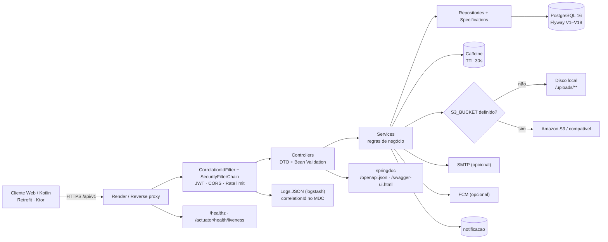
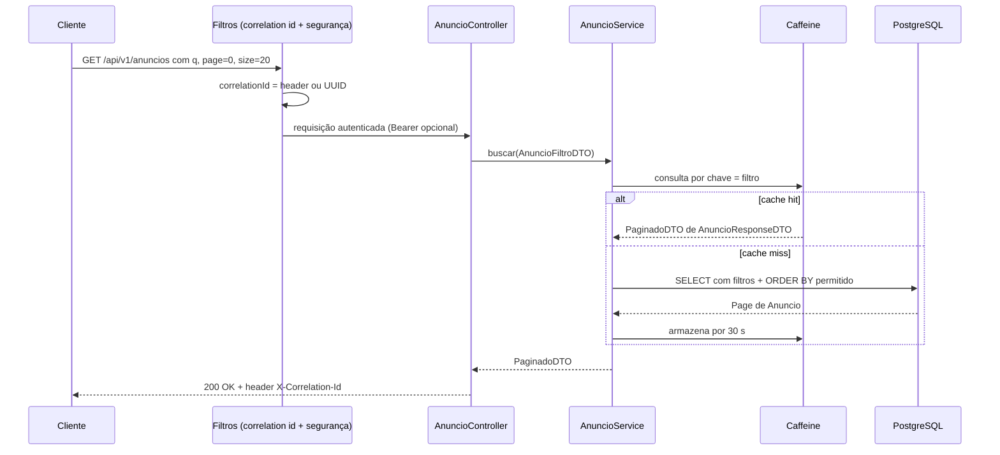
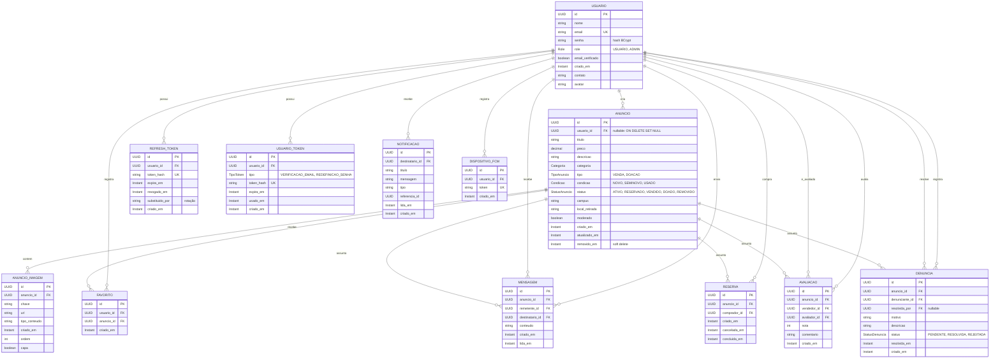

# Desapego Universitário — Backend

- **URL base (produção):** https://desapego-universitario-be.onrender.com/api/v1
- **Documentação interativa:** `/swagger-ui.html` · **Contrato exportável:** `/openapi.json`
- **Guias:** [API para clientes](docs/API.md) · [Versionamento e depreciação](docs/VERSIONAMENTO.md)

Marketplace de economia circular para estudantes universitários: anúncios de venda ou doação de
livros, eletrônicos, móveis e outros itens dentro do campus. Projeto do desafio técnico do
processo seletivo do Laboratório Vortex (Unifor), etapa VORTEX 2026.2.

Este repositório contém apenas o backend, uma API REST em Spring Boot. O frontend fica no
repositório separado `desapego-universitario-fe`.

---

## Visão geral

A API cobre o ciclo completo do marketplace:

- **Conta:** cadastro com e-mail institucional, verificação, recuperação de senha, login JWT e rotação de refresh token.
- **Anúncio:** criação, edição, busca paginada com filtros/ordenação, upload de imagens e moderação.
- **Interação:** favoritos, mensagens entre comprador e vendedor, reserva, conclusão da negociação e avaliações.
- **Confiança:** denúncias com fila de moderação para administradores.
- **Engajamento:** notificações no banco com push opcional via Firebase Cloud Messaging.
- **Operação:** OpenAPI, Actuator, logs estruturados, cache, migrações versionadas e CI.

Rotas públicas: cadastro/login/recuperação, `GET /api/v1/anuncios` (listagem, detalhe e
`/categoria/{categoria}`), `GET /uploads/**`, Swagger/OpenAPI, `/healthz` e
`/actuator/health[/**]`. Demais rotas exigem `Authorization: Bearer <accessToken>`;
rotas `/api/v1/admin/**` e `/actuator/metrics` exigem `ROLE_ADMIN`.

---

## Stack

| Camada | Tecnologia |
| --- | --- |
| Linguagem / runtime | Java 21 |
| Framework | Spring Boot 4.1.0 (Web MVC, Validation, Data JPA, Security, Mail, Cache, Actuator) |
| Segurança | Spring Security + JWT JJWT 0.12.6, BCrypt, CORS, rate limit por IP e por e-mail |
| Persistência | PostgreSQL 16, Hibernate, Spring Data JPA, Flyway (V1–V18) |
| Cache | Caffeine (máx. 500 entradas, TTL de 30 s) |
| Documentação | springdoc-openapi 3.2.0 (Swagger UI + `/openapi.json`) |
| Armazenamento | AWS SDK S3 2.31.78 (S3 ou compatível) ou disco local em desenvolvimento |
| Notificações | Firebase Cloud Messaging (opcional) + persistência de notificações |
| Build | Maven Wrapper (`./mvnw`), Lombok |
| Testes | JUnit 5, Mockito, MockMvc, H2 em modo PostgreSQL, Testcontainers |
| Qualidade | JaCoCo (gate de 80% em `service`/`controller` no `test`/`verify`), SpotBugs (job separado no CI), GitHub Actions |
| Deploy | Dockerfile multi-stage (usuário não root), Docker Compose, Render |

---

## Arquitetura



Fluxo típico de uma listagem pública, incluindo cache e correlation id:



### Estrutura de pacotes

```
src/main/java/com/marketplace/desapegoUniversitario/
├── config/       # Security, OpenAPI, cache, Jackson, CORS, mail, FCM, storage, correlation id
├── controller/   # endpoints REST e contratos de entrada/saída
├── domain/       # entidades JPA e enums
├── dto/          # records de request/response (com exemplos no OpenAPI)
├── exception/    # regras de negócio e GlobalExceptionHandler
├── mapper/       # conversão entidade -> DTO
├── repository/   # Spring Data JPA e Specifications de busca
├── security/     # JwtService, filtros JWT/rate limit, handlers
├── service/      # regras de negócio e integrações (S3, SMTP, FCM)
├── util/         # Paginas, helpers
└── validation/   # validadores customizados
```

---

## Modelo de dados



Convenções do modelo: IDs são UUID; datas são `Instant` gravadas em `TIMESTAMP WITH TIME ZONE`
e serializadas como ISO 8601 UTC (`...Z`); enums usam `@Enumerated(EnumType.STRING)` em
`UPPER_SNAKE_CASE` com `CHECK` constraints; a remoção de anúncio é lógica (`removido_em`).

As migrações Flyway (`src/main/resources/db/migration`) evoluíram de `V1__baseline` até
`V18__motivo_denuncia_enum`. Todas são aditivas: `V13` normaliza enums e adiciona constraints sem
recriar tabelas; `V14` cria índices para listagem por `removido_em/criado_em`, categoria,
preço, status e usuário; `V16` adiciona `ordem`/`capa` às imagens e espelha a capa no campo
legado `anuncio.imagem`; `V17` adiciona `contato` e `avatar` ao perfil; `V18` normaliza o
motivo das denúncias em enum. O Hibernate roda com `ddl-auto=validate` e o Flyway com
`clean-disabled=true`.

---

## Como rodar

### Local

Pré-requisitos: JDK 21+, PostgreSQL acessível e o Maven Wrapper incluído no repositório.

```bash
cp .env.example .env          # ajuste JDBC_URL, DB_USERNAME, DB_PASSWORD e JWT_SECRET
./mvnw spring-boot:run
```

A API sobe em `http://localhost:8080`. Para subir só o banco com Docker:

```bash
docker compose up -d db
```

Para executar o jar já empacotado:

```bash
./mvnw package -DskipTests
java -jar target/desapegoUniversitario-0.0.1-SNAPSHOT.jar
```

**Perfis:** `dev` (padrão, PostgreSQL local), `test` (H2 em memória) e `prod` (PostgreSQL de
produção). O perfil é definido por `SPRING_PROFILES_ACTIVE`.

### Docker

O `Dockerfile` é multi-stage: compila com Maven/Temurin 21 e gera uma imagem final com JRE,
usuário não root (UID/GID 10001), storage em `/tmp` e healthcheck em `/healthz`.

```bash
docker compose up -d --build      # API + PostgreSQL
docker compose logs -f api
docker compose down               # mantém o volume postgres-data
docker compose down -v            # remove também o volume
```

A API fica em `http://localhost:8080`. Variáveis como `API_PORT`, `DB_PORT`, `DB_NAME`,
`DB_USERNAME`, `DB_PASSWORD` e `JWT_SECRET` são lidas do `.env` pelo Compose.

**Render:** configure o *Health Check Path* como `/healthz`. Ele responde
`200 {"status":"ok"}` sem tocar banco ou dependências externas, evitando falsos negativos no
cold start. Para diagnóstico completo, use `/actuator/health`; para liveness,
`/actuator/health/liveness`.

### Testes

```bash
./mvnw test                                      # suíte + relatório e gate JaCoCo (80% em service/controller)
./mvnw clean verify                              # build completo: limpa, compila, testa e aplica o gate JaCoCo
./mvnw -DskipTests compile spotbugs:check        # análise estática (não roda no verify; job separado no CI)
```

- Testes unitários com JUnit 5 e Mockito cobrem as regras dos services.
- Testes de integração usam MockMvc com H2 em modo PostgreSQL; com Docker disponível, o teste com
  Testcontainers sobe PostgreSQL 16 real. Sem Docker ele roda no H2 e não é ignorado.
- O JaCoCo falha `test` e `verify` se a cobertura de linha em `service` ou `controller` ficar abaixo de 80%.
- O SpotBugs não está acoplado ao ciclo de vida do Maven: roda só no job `static-analysis` do CI (ou
  manualmente via `spotbugs:check`), com `failOnError=true` e filtro em `spotbugs-exclude.xml`.
- Relatórios: `target/site/jacoco/index.html` (cobertura) e `target/spotbugsXml.xml` (SpotBugs).

---

## Variáveis de ambiente

A maioria das variáveis está em [`.env.example`](.env.example); as demais têm default em
`src/main/resources/application.properties`. Nenhum segredo é versionado.

| Variável | Default | Uso |
| --- | --- | --- |
| `SPRING_PROFILES_ACTIVE` | `dev` | Perfil ativo (`dev`, `test`, `prod`) |
| `PORT` | `8080` | Porta HTTP |
| `JDBC_URL`, `DB_USERNAME`, `DB_PASSWORD` | — | Conexão PostgreSQL (obrigatórios em `prod`) |
| `DB_POOL_MAX_SIZE`, `DB_POOL_MIN_IDLE`, `DB_POOL_CONNECTION_TIMEOUT_MS` | `10`, `2`, `30000` | Pool HikariCP |
| `JDBC_TIME_ZONE` | `UTC` | Time zone JDBC |
| `JWT_SECRET` | vazio | Segredo HS256 (obrigatório em produção, mínimo 32 bytes) |
| `JWT_ACCESS_TOKEN_TTL`, `JWT_REFRESH_TOKEN_TTL` | `PT15M`, `P7D` | Validade dos tokens |
| `EMAIL_DOMINIOS_INSTITUCIONAIS` | `edu.br,edu,ac.br` | Domínios aceitos no cadastro |
| `RATE_LIMIT_LOGIN`, `RATE_LIMIT_CADASTRO`, `RATE_LIMIT_JANELA` | `5`, `3`, `PT1M` | Limites por IP e por e-mail |
| `RESERVA_TTL` | `PT24H` | TTL da reserva ativa antes da expiração automática |
| `MAIL_HOST`, `MAIL_PORT`, `MAIL_USERNAME`, `MAIL_PASSWORD`, `MAIL_FROM` | vazios / `587` | SMTP; sem `MAIL_HOST` nada é enviado |
| `MAIL_SMTP_AUTH`, `MAIL_STARTTLS` | `true` | Autenticação/TLS do SMTP |
| `FRONTEND_URL` | `http://localhost:5173` | URL usada nos links de e-mail |
| `EMAIL_VERIFICATION_TTL`, `PASSWORD_RESET_TTL` | `PT24H`, `PT1H` | Validade dos tokens de e-mail |
| `S3_BUCKET`, `S3_REGION`, `S3_ENDPOINT`, `S3_ACCESS_KEY`, `S3_SECRET_KEY`, `S3_PUBLIC_BASE_URL`, `S3_PREFIX` | vazios / `us-east-1` / vazio / `anuncios` | Storage; sem bucket, usa disco local. `S3_PUBLIC_BASE_URL` opcional sobrescreve a base pública da imagem (útil para R2/CDN/domínio customizado) |
| `STORAGE_LOCAL_DIR`, `STORAGE_MAX_IMAGENS`, `STORAGE_MAX_TAMANHO` | `/tmp/desapego-uploads`, `5`, `2MB` | Limites de upload local |
| `MULTIPART_MAX_FILE_SIZE`, `MULTIPART_MAX_REQUEST_SIZE` | `10MB`, `25MB` | Limites de infra do multipart |
| `FCM_CREDENTIALS`, `FCM_PROJECT_ID`, `FCM_SCOPE`, `FCM_OAUTH_URL`, `FCM_SEND_URL` | vazios / URLs padrão FCM | Push opcional; sem credencial, apenas notificação no banco |
| `FCM_DEVICE_TTL`, `FCM_CLEANUP_LOTE` | `P90D`, `500` | Tokens antigos são removidos em lotes ao registrar dispositivo ou notificar; tokens recusados pelo FCM são removidos na hora |
| `JPA_SHOW_SQL`, `JPA_FORMAT_SQL`, `SQL_LOG_LEVEL` | `false`, `false`, `WARN` | Logs SQL (nunca ligar bind de parâmetros) |
| `LOG_FORMAT`, `LOG_LEVEL_ROOT`, `APP_VERSION` | `logstash`, `INFO`, `1.0.0` | Logs JSON e metadados do `/actuator/info` |
| `OPENAPI_ENABLED`, `SWAGGER_UI_ENABLED` | `true` | Documentação da API |
| `CORS_ALLOWED_ORIGINS` | `http://localhost:5173` | Origens permitidas (separadas por vírgula) |
| `FORWARD_HEADERS_STRATEGY` | `native` | Usar `native` em produção: o `X-Forwarded-For` só é aceito de `RATE_LIMIT_TRUSTED_PROXIES` (com `framework`, o Spring reescreve o IP antes do rate limit e permite forjamento) |
| `RATE_LIMIT_TRUSTED_PROXIES` | faixas privadas/loopback em prod | Regex Java dos proxies confiáveis; usada tanto pelo filtro de rate limit quanto pela `RemoteIpValve` do Tomcat |
| `API_PORT`, `DB_PORT`, `DB_NAME` | `8080`, `5432`, `desapego_universitario` | Portas/nome do banco no Docker Compose |

---

## Endpoints principais

Documentação completa, payloads e códigos de resposta em [docs/API.md](docs/API.md) e no Swagger UI.

### Conta e autenticação

| Método | Rota | Observação |
| --- | --- | --- |
| POST | `/api/v1/usuarios/cadastro` | Público; exige e-mail institucional |
| POST | `/api/v1/usuarios/verificar-email` | Público |
| POST | `/api/v1/usuarios/reenviar-verificacao` | Público |
| POST | `/api/v1/usuarios/recuperar-senha` | Público |
| POST | `/api/v1/usuarios/redefinir-senha` | Público |
| POST | `/api/v1/usuarios/login` | Público; **deprecated** — alias legado de `/auth/login`, responde com headers `Deprecation`/`Sunset`; use `/auth/login` |
| POST | `/api/v1/auth/login` | Público; retorna access + refresh token |
| POST | `/api/v1/auth/refresh` | Público; rotaciona o refresh token |
| POST | `/api/v1/auth/logout` | Bearer; revoga os refresh tokens |

### Anúncios e imagens

| Método | Rota | Observação |
| --- | --- | --- |
| GET | `/api/v1/anuncios` | Público; `q`, `categoria`, `tipo`, `condicao`, `status`, `precoMin`, `precoMax`, `campus`, `page`, `size`, `sort` |
| GET | `/api/v1/anuncios/{id}` | Público |
| GET | `/api/v1/anuncios/categoria/{categoria}` | Público |
| POST | `/api/v1/anuncios` | Bearer |
| PUT / PATCH | `/api/v1/anuncios/{id}` | Bearer; somente o dono e anúncio `ATIVO` (senão 409) |
| DELETE | `/api/v1/anuncios/{id}` | Bearer; somente o dono (soft delete) |
| POST | `/api/v1/anuncios/{id}/imagens` | Bearer; `multipart/form-data`, campo `imagens`, até 5 imagens de 2 MB |
| GET / DELETE | `/api/v1/anuncios/{id}/imagens[/{imagemId}]` | Bearer; somente o dono; ordem crescente |
| PATCH | `/api/v1/anuncios/{id}/imagens/{imagemId}/capa` | Bearer; somente o dono; `imagem` do anúncio espelha a capa |

### Interação e perfil

| Método | Rota | Observação |
| --- | --- | --- |
| POST / DELETE | `/api/v1/anuncios/{id}/favoritos` | Bearer; não permite próprio anúncio, duplicado retorna 409 |
| GET | `/api/v1/usuarios/me/favoritos` | Bearer; paginado |
| POST / GET | `/api/v1/anuncios/{id}/mensagens` | Bearer; somente comprador da reserva e vendedor |
| GET | `/api/v1/mensagens/conversas` (alias: `/api/v1/usuarios/me/conversas`) | Bearer; lista conversas do usuário |
| PATCH | `/api/v1/mensagens/{id}/lida` | Bearer |
| POST / GET / DELETE | `/api/v1/anuncios/{id}/reserva` | Bearer; GET só para comprador/vendedor |
| GET | `/api/v1/usuarios/me/reservas` | Bearer; histórico paginado, reservas expiram após `RESERVA_TTL` |
| POST | `/api/v1/anuncios/{id}/conclusao` | Bearer |
| POST | `/api/v1/anuncios/{id}/avaliacoes` | Bearer |
| GET | `/api/v1/usuarios/{id}/avaliacoes` | Bearer; média e histórico de avaliações do vendedor |
| GET / PATCH | `/api/v1/usuarios/me` | Bearer; PATCH edita `nome`, `contato` e `avatar` (URL `/uploads/` ou `https://`) |
| GET | `/api/v1/usuarios/me/anuncios` | Bearer; histórico paginado |
| POST | `/api/v1/anuncios/{id}/denuncias` | Bearer; `motivo` é enum (`FRAUDE`, `SPAM`, `PRODUTO_PROIBIDO`, `DUPLICADO`, `OFENSA`, `OUTROS`) |
| GET | `/api/v1/usuarios/me/denuncias[/{id}]` | Bearer; acompanhamento pelo denunciante, paginado |

### Notificações, moderação e operação

| Método | Rota | Observação |
| --- | --- | --- |
| GET | `/api/v1/notificacoes` e `/nao-lidas` | Bearer; paginado |
| PATCH | `/api/v1/notificacoes/{id}/lida` | Bearer |
| POST / DELETE | `/api/v1/notificacoes/dispositivo` | Bearer; token FCM |
| GET | `/api/v1/admin/denuncias` | ADMIN; paginado |
| POST | `/api/v1/admin/denuncias/{id}/resolucao` | ADMIN |
| PATCH | `/api/v1/admin/anuncios/{id}/moderacao` | ADMIN |
| DELETE | `/api/v1/admin/anuncios/{id}` | ADMIN |
| GET | `/healthz`, `/actuator/health`, `/actuator/health/**` | Público; health leve (Render), health completo e probes (`liveness`, `readiness`) |
| GET | `/actuator/info` | Bearer; metadados da aplicação |
| GET | `/actuator/metrics` | ADMIN; nomes de métricas |
| GET | `/v3/api-docs`, `/openapi.json`, `/swagger-ui.html` | Documentação |

Paginações usam `page` (base 0), `size` (1–100, padrão 20) e o envelope `PaginadoDTO<T>` com
`content`, `page`, `size`, `totalElements`, `totalPages`, `first` e `last`. Erros seguem o
`ErroResponse` (`timestamp`, `status`, `codigo`, `mensagem`, `caminho`, `correlationId`, `erros`); clientes devem
tratar pelo `codigo`, nunca pela mensagem.

---

## Decisões técnicas

- **DTOs nas bordas:** entidades nunca são expostas diretamente; `Usuario` jamais trafega com a senha, e os DTOs carregam exemplos no OpenAPI.
- **UUID e datas canonizadas:** IDs UUID e `Instant` em UTC eliminam ambiguidade de timezone entre cliente, API e banco.
- **Enums estáveis:** persistência como string em `UPPER_SNAKE_CASE`, aceitação case-insensitive na entrada e `CHECK` constraints no banco.
- **Migrações aditivas:** Flyway `V1`–`V18` sem destruir dados; `V13` normaliza enums, `V14` cria índices para os filtros mais usados e as versões seguintes evoluíram reserva, imagens, perfil e motivos de denúncia.
- **Busca controlada:** `Specification` com whitelist de ordenação e validação de `page`/`size`/faixa de preço, evitando SQL dinâmico arbitrário e consultas custosas.
- **Cache curto:** Caffeine com TTL de 30 s nas listagens públicas e invalidação em escritas; dados obsoletos ficam limitados a essa janela.
- **Tokens com rotação:** access token de 15 min e refresh de 7 dias de uso único; reutilização revoga a família de tokens. Hash de tokens e senhas nunca é logado.
- **Integrações opcionais:** sem `S3_BUCKET` o storage é local; sem `FCM_CREDENTIALS` as notificações ficam apenas no banco; sem `MAIL_HOST` nenhum e-mail é enviado.
- **Contrato publicado:** `/openapi.json` é a fonte para gerar clientes Kotlin; mudanças incompatíveis exigem nova versão de URL, conforme `docs/VERSIONAMENTO.md`.
- **Observabilidade:** correlation id gerado/propagado por requisição no header `X-Correlation-Id` e no MDC; logs no formato estruturado `logstash`; Actuator expõe health (público), info (Bearer) e metrics (ADMIN).
- **Deploy e CI:** imagem multi-stage com usuário não root e healthcheck, Compose com PostgreSQL, e pipeline GitHub Actions com build, testes e gate JaCoCo, relatórios de teste/cobertura publicados como artefatos, SpotBugs em job separado e build/push da imagem.
- **Cold start:** `/healthz` responde sem consultar dependências, separando "processo vivo" de "dependências prontas" (`/actuator/health`).
- **Licença e automação:** MIT (`LICENSE`), Dependabot para Maven e GitHub Actions, e job de CodeQL no CI.

---

<p align=center>Diário de Bordo da IA</p>

### Ferramentas Utilizadas
- Claude (Anthropic) — usado ao longo de todo o desenvolvimento do backend.

### Estratégia de Engenharia de Prompts

Exemplo 1 — decisão de arquitetura (DTO vs expor entidade direto):
Ao planejar cadastro/login, perguntei se deveria usar DTOs. Discuti com a IA por que a entidade `Anuncio` podia ser exposta direto no Controller sem problema, mas `Usuario` (por ter campo de senha) exigia DTOs separados de entrada e saída — decisão de design, não só sintaxe.

Exemplo 2 — organização do histórico de commits:
Percebi que tinha acumulado várias mudanças (entidade, service, repository, DTOs, controller) sem organizar em commits — inclusive com arquivos ficando "staged" com versão desatualizada em relação ao que eu tinha escrito depois. Pedi ajuda pra revisar isso com `git diff`, usar `git reset` pra desfazer staging incorreto, e separar os commits por grupo lógico de arquivos.

Exemplo 3 — avaliação de escopo (autenticação JWT):
Não conhecia JWT antes desse desafio. Pedi pra IA explicar o conceito e implementei uma classe `JwtUtil` funcional (geração e validação de token) com revisão da IA. Depois, avaliando o tempo restante e o que ainda faltava (frontend/PWA obrigatório, ainda não iniciado), decidi remover o JWT do escopo do projeto.

Exemplo 4 — contrato estável e documentação:
Solicitei a geração do `openapi.json` com exemplos e códigos de resposta, defini formato único de erro e pedi revisão do contrato antes de cada merge. A IA apontou inconsistências entre datas, enums e paginação; padronizei ISO 8601 UTC, enums canônicos e o envelope `PaginadoDTO`, e registrei as regras em `docs/VERSIONAMENTO.md`.

Exemplo 5 — qualidade e infraestrutura:
Pedi cobertura mínima de 80% em service e controller com JaCoCo, Testcontainers para PostgreSQL e análise estática no CI. A IA sugeriu excluir falsos positivos de injeção do Spring no SpotBugs; mantive o filtro restrito a padrões conhecidos e corrigi o problema real de `getParent()` nullable no storage local.

Exemplo 6 — deploy e cold start:
Solicitei Dockerfile multi-stage com usuário não root, Compose com PostgreSQL e um health check leve para o Render. Defini `/healthz` separado do `/actuator/health` para não confundir "processo vivo" com "banco pronto", e documentei o caminho no README.

### Reflexão Crítica
A implementação de JWT chegou a funcionar, mas percebi que mantê-la comprometeria o tempo necessário pra entregar o restante do desafio dentro do prazo. Naquele momento, removi o JWT do escopo e mantive cadastro e login apenas com validação de email/senha (hash via BCrypt), sem geração de token. Foi um momento de precisar avaliar criticamente o que a IA ajudou a construir — só porque algo funciona não significa que cabe no escopo e no tempo disponíveis. O JWT depois voltou ao escopo (Fases 4 e 5), com access token, refresh de uso único e rotação com revogação por família; o código atual reflete essa segunda decisão.

Reflexão adicional (Fases 4 e 5): o JWT voltou ao escopo depois que o core do marketplace ficou estável, com rotação de refresh e revogação por família. Decisões posteriores priorizaram contrato previsível para o cliente Kotlin, migrações sem perda de dados e observabilidade desde o primeiro deploy — cada mudança de contrato passou a ser revisada no `openapi.json` e acompanhada de teste de integração.
